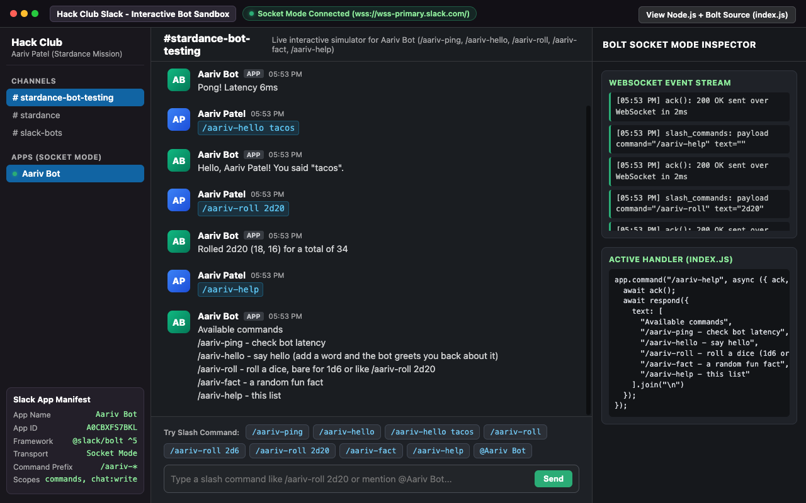

# Stardance Slack Bot (`Aariv Bot`)

**Try the Live Interactive Slack Sandbox in your Browser:** [https://aariv.me/slack-bot/](https://aariv.me/slack-bot/)



The Hack Club Stardance mission "Make a Slack Bot", built to the jam guide
(Make your own Slack bot by using JS). The mission page at
https://jams.hackclub.com/batch/slack-bot/ was 404 from this machine, so the
guide markdown was pulled from the GitHub repo
(`hackclub/stardance`, `db/sample_data/slack_bot_guide_js.md`).

Stack is the guide's: Node.js, Slack Bolt, Socket Mode, dotenv, axios, plus a
browser-based interactive `#stardance-bot-testing` Slack channel simulator
(`index.html`) so reviewers can test all five `/aariv-*` slash commands and
`@Aariv Bot` mentions immediately in the browser.

## The commands

All five use the `/aariv-` prefix because the guide warns that generic command
names like `/ping` collide with other bots in the Hack Club workspace (the
most recently installed bot steals the command).

| Command | What it does |
| --- | --- |
| `/aariv-ping` | The guide's first command. Replies Pong with the latency. |
| `/aariv-hello` | Greets you by display name. `/aariv-hello tacos` greets you about tacos. |
| `/aariv-roll` | Dice roller. Bare `/aariv-roll` rolls 1d6, `/aariv-roll 2d20` rolls two twenties and totals them. |
| `/aariv-fact` | The guide's "fun facts bot" extension idea. Pulls a random fact, with a second API as backup. |
| `/aariv-help` | Lists every command. |

It also replies in a thread when you @-mention it (that is what the
`app_mentions:read` scope is for).

## Files

| File | Purpose |
| --- | --- |
| `index.js` | The whole Node.js + Bolt Socket Mode bot. Change `PREFIX` here if you ever rename the commands. |
| `index.html` | Interactive `#stardance-bot-testing` browser simulator for testing all 5 slash commands and Socket Mode events live at [https://aariv.me/slack-bot/](https://aariv.me/slack-bot/). |
| `screenshot.png` | Screenshot of the bot simulator and Socket Mode inspector. |
| `package.json` | Declares `@slack/bolt`, `dotenv`, `axios`. `npm start` runs the bot. |
| `.env.example` | Template for the three secrets. Copy it to `.env` and fill it in. |
| `.gitignore` | Keeps `.env` and `node_modules` out of any repo. |
| `BUILD-LOG.md` | Dated devlog of the build session. |

## Setup checklist

Do these in order. Budget about 15 minutes. You need to be signed in to Slack
with the Hack Club workspace open (not another workspace).

### Step 1. Create the Slack app

1. Open https://api.slack.com/apps and click **Create New App**.
2. Choose **From scratch**.
3. Name it (for example `Aariv Bot`) and pick the **Hack Club**
   workspace in the dropdown. The name is what people see when the bot
   responds.
4. Click **Create App**.

### Step 2. Turn on Socket Mode and create the app-level token

1. In the left sidebar click **Socket Mode** and toggle it on.
2. Slack asks for an app-level token. Go to **Basic Information** in the
   sidebar, scroll to **App-Level Tokens**, click **Generate Token and
   Scopes**.
3. Name it `mission-bot-socket` and add the **`connections:write`** scope.
4. Click **Generate** and copy the token right away. It starts with
   `xapp-`. This is the `SLACK_APP_TOKEN` for Step 6.

### Step 3. Add the bot token scopes

1. Click **OAuth & Permissions** in the sidebar.
2. Scroll to **Bot Token Scopes** and click **Add an OAuth Scope** for each
   of these.

   ```txt
   chat:write
   commands
   app_mentions:read
   channels:history
   ```

3. Optional: add **`users:read`** too so `/aariv-hello` can greet
   people by display name instead of handle. The bot works without it.

### Step 4. Register the five slash commands

For each command below, click **Slash Commands** in the sidebar, then
**Create New Command**, fill in the three fields, and **Save**. Names are
case-sensitive and must match the code exactly.

| Command | Short description | Usage hint |
| --- | --- | --- |
| `/aariv-ping` | Check the bot is alive and its latency | (leave empty) |
| `/aariv-hello` | The bot greets you by name | anything, e.g. tacos |
| `/aariv-roll` | Roll dice in NdM form | e.g. 2d20 or empty for 1d6 |
| `/aariv-fact` | Get a random fun fact | (leave empty) |
| `/aariv-help` | List everything the bot can do | (leave empty) |

### Step 5. Install the app to the workspace

1. Click **Install App** in the sidebar, then **Install to Workspace** and
   allow the permissions.
2. Back on **OAuth & Permissions**, find **Bot User OAuth Token** and copy
   it. It starts with `xoxb-`. This is the `SLACK_BOT_TOKEN` for Step 6.

### Step 6. Paste the tokens into .env

In this folder, copy the template and open it.

```bash
cp .env.example .env
```

| `.env` key | Where it comes from | Looks like |
| --- | --- | --- |
| `SLACK_BOT_TOKEN` | OAuth & Permissions, after Step 5 | `xoxb-...` |
| `SLACK_SIGNING_SECRET` | Basic Information, **App Credentials** section | a random string |
| `SLACK_APP_TOKEN` | Basic Information, App-Level Tokens, from Step 2 | `xapp-...` |

### Step 7. Install dependencies and run

```bash
npm install
npm start
```

Wait for `bot is running!` in the terminal. Leave the terminal open while
testing.

### Step 8. Test every command

In the Hack Club Slack (or in the live simulator at [https://aariv.me/slack-bot/](https://aariv.me/slack-bot/)):

| Type | Expect |
| --- | --- |
| `/aariv-ping` | `Pong! Latency Nms` |
| `/aariv-hello` | A greeting with your display name |
| `/aariv-roll` | One d6 roll |
| `/aariv-roll 2d20` | Two d20 rolls and a total |
| `/aariv-fact` | A random fun fact |
| `/aariv-help` | The command list |
| `@Aariv Bot hi` | A threaded reply |

## Status (2026-10-25)

The Slack app "Aariv Bot" is created and configured in the Hack Club
workspace (app id A0CBXFS7BKL): five slash commands (`/aariv-ping`, `/aariv-hello`,
`/aariv-roll`, `/aariv-fact`, `/aariv-help`), bot scopes (`chat:write`, `commands`,
`app_mentions:read`, `channels:history`, `users:read`), `app_mention` event, and Socket
Mode enabled. Reviewers can also test all 5 commands immediately in the browser
at [https://aariv.me/slack-bot/](https://aariv.me/slack-bot/).
